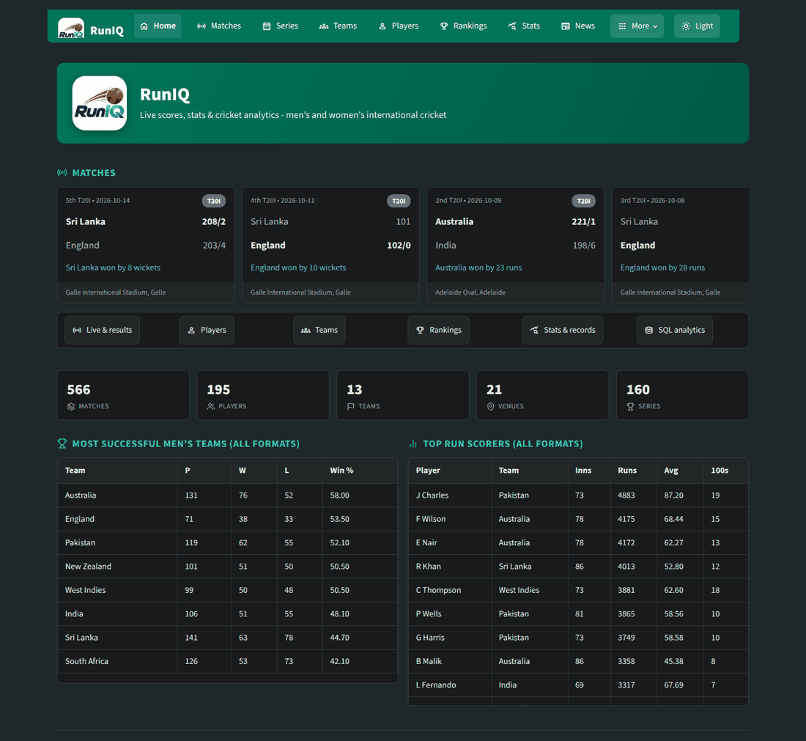
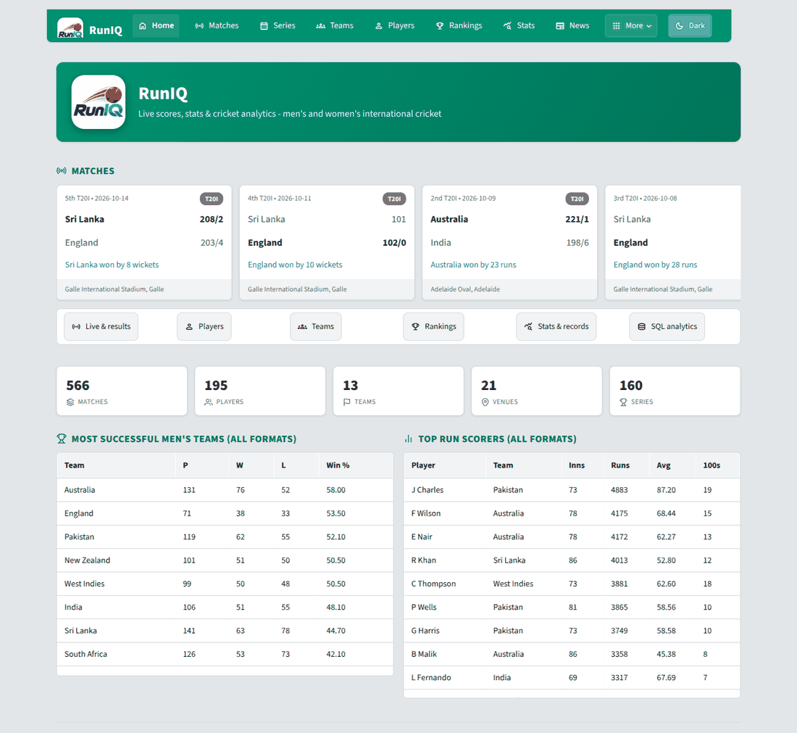

<div align="center">

<p align="center"><b>RunIQ</b> - live scores, real match statistics and SQL analytics for international cricket</p>

**[Live App →](https://runiqlive.streamlit.app)**

</div>

---

# RunIQ

A multi-page **Streamlit** web app with a Cricbuzz-inspired look (dark by default, light on demand) that combines

* **real historical data** - every international Test, ODI and T20I, men's **and** women's, ball by ball, from [Cricsheet](https://cricsheet.org) (free, Open Data Commons Attribution License), stored in a **SQL database**
* **live data** - live / recent / upcoming matches, scorecards, commentary, ICC rankings, news and player profiles from the **Cricbuzz Cricket API** (RapidAPI, with your own key)
* the **25 SQL analytics questions** and **CRUD** module required by the project brief

> **Data honesty.** RunIQ does **not** scrape cricbuzz.com (its content and photos are copyrighted and its terms forbid scraping). Historical numbers come from Cricsheet, live numbers from the official Cricbuzz API. The screenshots in `documentation/screenshots/` were rendered from *simulated test data* (fictional players) because the build environment had no internet access; after you import the real data your screens will show real players.




## What you get

| Page | Source | Features |
|---|---|---|
| **Home** | API + DB | live strip, team success table, top run scorers, news, data status |
| **Matches** | API + DB | Live / Recent / Upcoming (men, women, international, league, domestic), full archive of every real match, "save to database" |
| **Match Centre** | API + DB | full scorecard (batting, bowling, extras, fall of wickets, did-not-bat), worm / Manhattan / run-rate charts, squads, live commentary |
| **Series** | API + DB | every real series with top performers; current and upcoming series from the API |
| **Teams** | DB + API | records by format, recent results, squads, head-to-head, Cricbuzz team lists / fixtures |
| **Players** | DB + API | search all past and present players, career stats per format, form, dismissals, vs opposition, best bowling, live Cricbuzz profiles |
| **Rankings** | API (+ saved snapshots) | ICC batting / bowling / all-rounder / team rankings for men and women; the *RunIQ Index* computed from real data |
| **Stats** | DB + API | batting, bowling, fielding, team and venue records with filters (format, gender, year) |
| **News** | API | headlines and stories |
| **SQL Analytics** | DB | the 25 questions (+Q22B), SQL shown, CSV download, guarded custom-SQL box |
| **Insights** | DB | bar, line, pie, scatter, heat-map and player-comparison charts |
| **Manage Data** | DB | validated CRUD for players, matches, career stats and venues |
| **Data & Settings** | - | one-click import of real data, API key check and endpoint test, API -> SQL sync, licences |

---

## 1. Run it step by step

**Needs:** Python 3.10+ (3.12 tested), internet for the first import, Git (optional).

```bash
# 1) open a terminal in the project folder (the one that contains main.py)
cd RunIQ

# 2) create and activate a virtual environment
python -m venv .venv
.venv\Scripts\activate            # Windows (PowerShell: .venv\Scripts\Activate.ps1)
source .venv/bin/activate         # macOS / Linux

# 3) install the dependencies
pip install -r requirements.txt

# (optional) open .env and paste your RAPIDAPI_KEY - see section 3

# 4) download and import the REAL match history (first time: a few minutes, ~100 MB download)
python -m scripts.import_cricsheet

# 5) start the app
streamlit run main.py
```

The browser opens at **http://localhost:8501**. Prefer clicking? Skip step 4, start the app, open **More -> Data & Settings** and press **Import real data from Cricsheet**.

Handy import options

```bash
python -m scripts.import_cricsheet --since-year 2015      # smaller and faster
python -m scripts.import_cricsheet --recent 7             # later: only matches added in the last 7 days
python -m scripts.import_cricsheet --zip tests_json.zip odis_json.zip t20s_json.zip   # files you downloaded yourself
python -m scripts.import_cricsheet --reset                # wipe the database first
```

## 2. What the import does

Cricsheet publishes one JSON file per match. RunIQ reads each file and stores

* the match (teams, venue, toss, result, player of the match, series), both innings with per-over run data and fall of wickets
* every batter's, bowler's and fielder's figures for the match
* then derives players' main team, **playing role**, active / retired flag, venue country, stadium capacity, series dates and **career statistics** for each format

Re-running is safe: matches already imported are skipped. Cricsheet withholds a few hundred matches (for example Afghanistan's) and publishes matches a few days after they are played.

## 3. Add your Cricbuzz API key (optional, for live data)

1. Sign up at <https://rapidapi.com>, open **Cricbuzz Cricket** (by *Cricket API*), choose a plan (a free plan exists if shown on the Pricing tab) and **Subscribe**.
2. Choose API version **v1** in the version dropdown if you can (RunIQ's routes follow it; it also tries the newer `/matches/...` style routes automatically).
3. Copy your key into `.env` as `RAPIDAPI_KEY=...` (same folder as `main.py`, no quotes) and restart the app.
4. Check it works:

```bash
python -m scripts.check_api        # tests about 20 endpoints and prints OK / FAILED
```

or press **Test all endpoints** on the *Data & Settings* page. A `404` means your plan/version uses different paths - edit `api/endpoints.py` (all routes live there) or send the output to whoever maintains the project.
Without a key the whole app still works: live pages explain what is missing and the Archive, Teams, Players, Stats, SQL and CRUD pages use the imported history.

## 4. Tests

```bash
pip install -r requirements-dev.txt
python -m pytest -q          # 117 tests: parsers, importer, 26 SQL queries, CRUD, sync, API client, every page (dark and light, with and without a fake API)
```

The importer and queries are tested on *simulated* Cricsheet-format files (`tests/cricsheet_fixture.py`); the simulator is test-only and never used by the app.

## 5. Git

```bash
git init
git add .
git commit -m "RunIQ: initial commit"
git branch -M main
git remote add origin https://github.com/13msrajput/RunIQ
git push -u origin main
```
`.gitignore` already excludes `.env`, the virtual environment, the local database, downloaded zip files and logs.

## 6. Project structure

```
RunIQ/
├── main.py                    Home page (entry point: streamlit run main.py)
├── config.py                  settings from environment variables / .env
├── requirements.txt · requirements-dev.txt · .env.example · .gitignore · pytest.ini
├── .streamlit/config.toml     dark base theme
├── pages/                     1_Matches · 2_Match_Centre · 3_Series · 4_Teams · 5_Players · 6_Rankings
│                              7_Stats_and_Records · 8_News · 9_SQL_Analytics · 10_Insights · 11_Manage_Data · 12_Data_and_Settings
├── api/                       cricbuzz_client.py (retries, route fallback, error mapping) · endpoints.py (all routes)
├── services/                  cricsheet_importer · catalog_service (all read queries) · api_parsers · api_probe
│                              base_crud_service + player / match / career_stats / venue services
│                              sync_service (API -> SQL) · ranking_service · analytics_service · card_builders
├── models/                    schema.py (13 tables, constraints, indexes) · views.py · constants.py · venue_reference.py
├── sql/                       queries.py (the 25 questions + Q22B) · schema.sql
├── utils/                     db_connection · theme · icons · branding (embedded logo) · ui_helpers · api_cache
│                              validators · sql_guard · logger · exceptions
├── scripts/                   import_cricsheet · check_api · export_sql
├── tests/                     pytest suite (+ simulated Cricsheet-format fixtures)
├── documentation/             ARCHITECTURE · DATABASE_DESIGN · DATA_SOURCES · API_MAPPING · REQUIREMENTS_CHECKLIST · DEMO_VIDEO_SCRIPT · screenshots/
├── data/                      runiq.db and downloaded zips (git-ignored)
└── logs/                      app.log (git-ignored)
```

## 7. Design highlights

* **Clean layers:** pages -> services -> `utils/db_connection.py` -> database; the Cricbuzz client is isolated in `api/`.
* **Database agnostic:** SQLAlchemy Core tables; change `DATABASE_URL` for PostgreSQL / MySQL (only SQLite was tested).
* **Error handling everywhere:** custom exceptions (`APIAuthError`, `APIRateLimitError`, `APIError`, `DatabaseError`, `ValidationError`, `DataImportError`...) are turned into friendly messages by `utils/ui_helpers.show_error`; no raw tracebacks reach users.
* **API resilience:** timeouts, retries with back-off for 429 / 5xx, JSON validation, automatic fallback between `/matches/v1/..` and `/matches/..` style routes, Streamlit caching to save quota.
* **Security:** secrets only in `.env`; parameterised SQL; the custom-SQL box accepts one read-only SELECT; CRUD only edits whitelisted columns.
* **Transactions:** every write runs in `engine.begin()` (commit or roll back); imports commit in batches and fall back to match-by-match when a batch fails.
* **Branding:** the RunIQ logo is embedded as Base64 in `utils/branding.py` - no image file to manage.

## 8. Known limitations (please read)

* **First run needs internet** to download the Cricsheet files, and I could not download them while building. The importer follows Cricsheet's published JSON format and is tested on files in that format; if a real file surprises it, the import continues and lists the problem files.
* **Cricbuzz API routes** come from RapidAPI's documentation as I know it plus automatic fallbacks; they were tested with a fake client, not against your live plan. Run `python -m scripts.check_api` and adjust `api/endpoints.py` if something returns 404.
* Cricsheet names players as **"V Kohli"** (initials + surname) and has no photos, birth dates, batting or bowling styles. Roles are **derived** (keepers from stumpings, bowlers / all-rounders from bowling share and batting position). Venue countries come from a city list and stadium capacities from a static, approximate list (`models/venue_reference.py`); correct them on *Manage Data*.
* League cricket (IPL, BBL ...) and domestic matches appear live through the API but are not stored in the database.
* The theme is an independent, Cricbuzz-*inspired* design with RunIQ's own logo; it is not a copy of cricbuzz.com.

## 9. Troubleshooting

| Problem | Fix |
|---|---|
| "No match data yet" | run `python -m scripts.import_cricsheet` or use *Data & Settings* |
| Import: "Could not download" | check your internet / firewall, or download `tests_json.zip`, `odis_json.zip`, `t20s_json.zip` from cricsheet.org/downloads and pass them with `--zip` |
| "API KEY MISSING" | put `RAPIDAPI_KEY=...` in `.env` (not `.env.txt`) and restart Streamlit |
| API 403 | you have not subscribed to the API on RapidAPI |
| API 404 | route differs on your plan - run `python -m scripts.check_api` |
| API 429 | monthly quota used up |
| `ModuleNotFoundError` | activate the virtual environment and `pip install -r requirements.txt` |
| Page looks unstyled | use Streamlit 1.40+ (`pip install -U streamlit`) |

## 10. Credits and licences

* Match data: **Cricsheet** (cricsheet.org), Open Data Commons Attribution License v1.0.
* Live data: **Cricbuzz Cricket API** by *Cricket API* via RapidAPI, used under RapidAPI's terms with your own key.
* Icons: Material Symbols (Apache 2.0, bundled with Streamlit) and a Feather / Lucide-style inline SVG set (MIT / ISC).
* RunIQ is not affiliated with Cricbuzz, the ICC or any cricket board.
