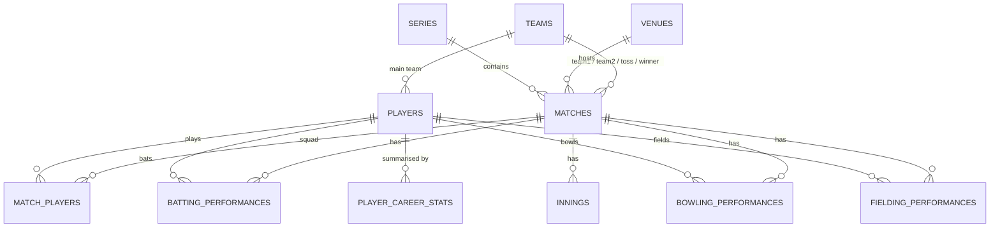

# RunIQ - Database design

## ER diagram

Standalone tables: `ranking_snapshots` (latest ICC rankings fetched from the API), `api_sync_log` (audit of API -> SQL syncs).

## Tables
| Table | Primary key | Foreign keys | Notes |
|---|---|---|---|
| teams | team_id | - | UNIQUE (team_name, gender); `display_name` = "India Women" |
| venues | venue_id | - | UNIQUE (venue_name, city); country and capacity derived |
| players | player_id | team_id -> teams | `cricsheet_id` UNIQUE; role / active flag derived |
| series | series_id | - | UNIQUE (series_name, gender, match_type) |
| matches | match_id | series_id, team1_id, team2_id, venue_id, toss_winner_id, winner_id, player_of_match_id | CHECKs: distinct teams, winner is one of them, valid enums; `match_year`, `match_quarter` derived |
| match_players | (match_id, player_id) | match_id, player_id, team_id | squad of each match |
| innings | innings_id | match_id, team_id | UNIQUE (match_id, innings_no); `over_runs_json`, `fow_json` |
| batting_performances | perf_id | match_id, player_id, team_id | UNIQUE (match, innings, player); batting position = order of arrival |
| bowling_performances | perf_id | match_id, player_id, team_id | `balls_bowled` (overs = balls / 6) |
| fielding_performances | perf_id | match_id, player_id, team_id | catches, stumpings, run-outs |
| player_career_stats | (player_id, match_format) | player_id | rebuilt after every import |
| ranking_snapshots, api_sync_log | log / snapshot id | - | API data |

Views: `vw_match_results`, `vw_player_batting_summary`.

## Normalisation
* **1NF** atomic columns (the two JSON text columns on `innings` are display-only chart data, never filtered in SQL). **2NF** every non-key column depends on the whole key (the composite-key table `player_career_stats` holds only per-(player, format) facts). **3NF** team, venue and series attributes live in their own tables.
* **Deliberate denormalisation:** `matches.match_year / match_quarter` (derived from `match_date`, kept in sync by the CRUD layer) make time grouping portable across databases; `player_career_stats` is a pre-aggregated summary table.

## Indexes (why)
`ix_matches_status_date` (latest matches), `ix_matches_date`, `ix_matches_format_gender`, `ix_matches_year_quarter` (Q16, Q25), `ix_batting_match_innings` (match, innings, team, position - partnership self-joins Q13 / Q24), `ix_batting_player` / `ix_bowling_player` (player aggregates and window partitions), `ix_players_role` (Q6), `ix_players_name` (search), foreign-key indexes on `matches`.

## Delete rules
Deleting a match or player cascades to their performance rows; teams and venues are RESTRICT (cannot be deleted while used).
